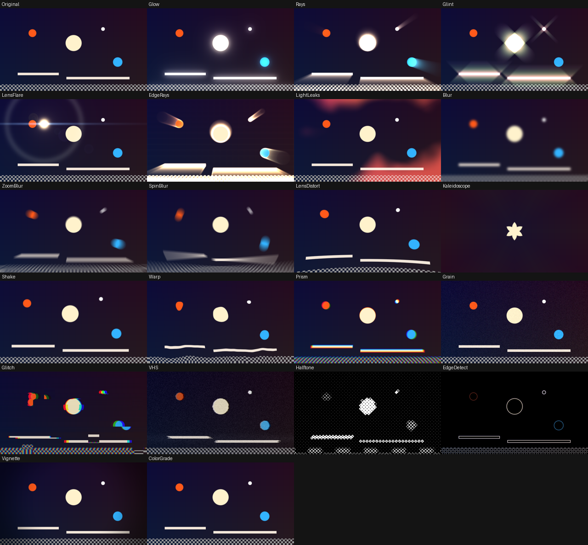

# Prisma FX

Pack de efectos open source (licencia BSD-3) para cualquier programa compatible con **OpenFX**: Autograph, DaVinci Resolve/Fusion, Nuke, Natron, Vegas, Flame…
La idea es ir recreando, uno a uno, el tipo de efectos que ofrecen suites comerciales como Sapphire o Universe, sin depender de Adobe. El plan completo, con la equivalencia de cada efecto, está en [docs/hoja-de-ruta.md](docs/hoja-de-ruta.md).



## Efectos incluidos (21)

| Efecto | Menú | Qué hace |
|---|---|---|
| **Glow** | Prisma FX / Light | Bloom suave a varias escalas a partir de las zonas brillantes. |
| **Rays** | Prisma FX / Light | Rayos volumétricos que salen de las zonas brillantes desde un punto central. |
| **Glint** | Prisma FX / Light | Destellos en estrella sobre los brillos, como un filtro de cruz. |
| **Lens Flare** | Prisma FX / Light | Flare procedural con halo, streak anamórfico y fantasmas; punto de luz animable. |
| **Edge Rays** | Prisma FX / Light | Rayos que salen de los bordes del alfa o de la luma. |
| **Light Leaks** | Prisma FX / Light | Fugas de luz orgánicas y animadas, con dos colores. |
| **Blur** | Prisma FX / Blur | Desenfoque gaussiano con aspecto y ángulo. |
| **Zoom Blur** | Prisma FX / Blur | Desenfoque radial de zoom desde un centro. |
| **Spin Blur** | Prisma FX / Blur | Desenfoque de giro alrededor de un centro. |
| **Lens Distort** | Prisma FX / Distort | Distorsión de barril y cojín. |
| **Kaleidoscope** | Prisma FX / Distort | Caleidoscopio de N segmentos o espejo simple. |
| **Shake** | Prisma FX / Distort | Temblor de cámara con rotación, zoom y desenfoque de movimiento. |
| **Warp** | Prisma FX / Distort | Distorsión orgánica con ruido animado. |
| **Prism** | Prisma FX / Stylize | Aberración cromática espectral, radial (tipo lente) o lineal. |
| **Film Grain** | Prisma FX / Stylize | Grano de película animado. Su tamaño no cambia con la resolución de previsualización. |
| **Glitch** | Prisma FX / Stylize | Daño digital: franjas desplazadas, bloques corruptos, separación RGB y scanlines. |
| **VHS** | Prisma FX / Stylize | Cinta gastada: jitter, banda de tracking, sangrado de color, ruido y scanlines. |
| **Halftone** | Prisma FX / Stylize | Trama de puntos de imprenta, en una tinta o en color. |
| **Edge Detect** | Prisma FX / Stylize | Bordes, dibujo a tinta o look cartoon. |
| **Vignette** | Prisma FX / Stylize | Viñeta con centro móvil. Es también el ejemplo de la guía para crear efectos. |
| **Color Grade** | Prisma FX / Color | Exposición, balance de blancos, lift/gamma/gain, contraste, saturación y bleach bypass. |

Todos trabajan en 8, 16 y 32 bits (float), por tiles y a cualquier escala de render (proxy).

## Instalar

1. Descarga `PrismaFX.ofx.bundle` desde los artefactos de GitHub Actions (o compílalo tú).
2. Cópialo a la carpeta de plugins OFX del sistema:
   - **Windows:** `C:\Program Files\Common Files\OFX\Plugins\`
   - **macOS:** `/Library/OFX/Plugins/`
   - **Linux:** `/usr/OFX/Plugins/`
3. Reinicia Autograph (o el programa que uses). Los efectos aparecen en el grupo **Prisma FX**.

## Compilar

Hace falta CMake 3.20 o superior y un compilador de C++17. Las cabeceras de OpenFX van incluidas en `external/`.

```sh
cmake -S . -B build -DCMAKE_BUILD_TYPE=Release
cmake --build build --config Release
```

El bundle queda en `build/bundle/PrismaFX.ofx.bundle`. En macOS añade `-DCMAKE_OSX_ARCHITECTURES="arm64;x86_64"` para generar un binario universal.

## Probar sin ningún programa

`ofxtest` es un host OpenFX mínimo de línea de comandos, construido sobre la librería HostSupport oficial. Carga el bundle igual que lo haría Autograph y renderiza una imagen:

```sh
build/ofxtest --bundle-dir build/bundle --list
build/ofxtest --bundle-dir build/bundle --plugin io.github.prismafx.Glow \
    --in entrada.ppm --out salida.ppm --param width=80 --param tint=1,0.6,0.3
ctest --test-dir build --output-on-failure
```

Los tests renderizan cada efecto en 8, 16 y 32 bits y a media resolución. En cada caso comprueban que el render por tiles coincide con el de fotograma completo, lo que detecta efectos que leen fuera de la zona de la imagen que declaran necesitar. Linux necesita `libexpat1-dev` y `python3-numpy` para los tests.

## Añadir un efecto nuevo

Un efecto nuevo es un único archivo `.cpp` en `src/effects/`. Declaras sus parámetros, escribes la función `render` sobre imágenes float RGBA y lo registras con una línea. CMake lo detecta solo, y la capa OFX genera la interfaz y se encarga de bits, tiles y escalas. Tienes la guía paso a paso en [docs/nuevo-efecto.md](docs/nuevo-efecto.md) y el plan de efectos en [docs/hoja-de-ruta.md](docs/hoja-de-ruta.md).

## Estructura

```
src/core/      Imagen float, parámetros, registro de efectos y utilidades (blur, ruido, mezcla)
src/ofx/       Puente genérico a OpenFX (el único código que habla OFX)
src/effects/   Un archivo por efecto, agrupados por categoría
tools/ofxtest/ Host de pruebas
tests/         Imagen de prueba y suite de tests
```

## Licencia

BSD-3-Clause. Las cabeceras de OpenFX en `external/openfx` son © OpenFX contributors, también con licencia BSD-3. Sapphire, Red Giant, Universe, Trapcode, Magic Bullet y After Effects son marcas de sus respectivos dueños. Este proyecto no tiene relación con ellos ni usa su código.
